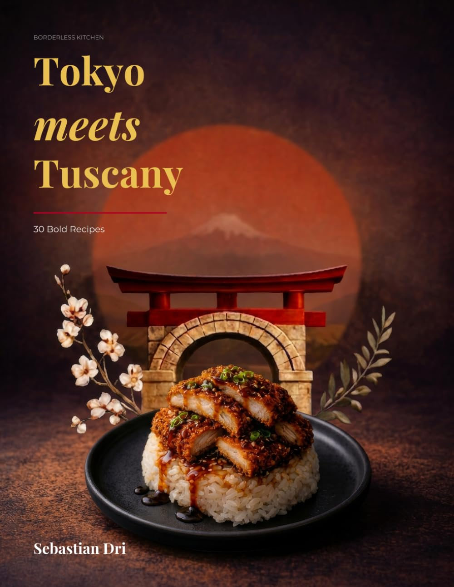

# Borderless Kitchen

<p>
  <a href="https://borderlesskitchenseries.com"><b>Live site</b></a> ·
  <a href="https://www.amazon.com/dp/B0GY8H2TCQ">Volume I on Amazon</a> ·
  <a href="https://sebastian-dri-portfolio.vercel.app">Author portfolio</a>
</p>



The editorial site and sales funnel for the **Borderless Kitchen** cookbook series, with one volume for each pair of culinary
traditions. Volume I, *Tokyo Meets Tuscany*, is published on Amazon.

I built and run the whole project myself: the brand, the books, this codebase, the content pipeline, email capture and the buy paths.
The site exists to turn a reader into an email subscriber and then into a buyer.

### At a glance

- **About 300 MDX documents**, all type-checked at build time: 155 journal stories, 100 free recipes, 38 pantry and culture
  entries, plus book pages.
- **Funnel:** free recipes and a lead magnet, then MailerLite signup into per-book lists, then Amazon, Gumroad and PDF bundles.
- **900+ commits and 44 merged pull requests.** Every branch gets a Vercel preview, and `main` deploys to production in about
  60 seconds.
- **Data integrity:** testimonials must be marked as verified or the build fails. Recipe teasers can't carry the full recipe, so
  paid content stays paid.
- **SEO:** each recipe has its own metadata, a canonical origin, a sitemap and Vercel Analytics.

## Stack

Next.js 15 (App Router) · React 19 · TypeScript · Tailwind 3.4 · [Contentlayer2](https://github.com/timlrx/contentlayer2)
for MDX · Framer Motion · Vercel Analytics · MailerLite API.

## Quick start

```bash
npm install
npm run dev          # http://localhost:3000
```

| Script | Does |
|---|---|
| `npm run dev` | Dev server |
| `npm run build` | Production build (regenerates Contentlayer types) |
| `npm run start` | Serve a production build |
| `npm run lint` | ESLint |
| `npm run typecheck` | `tsc --noEmit` |

Contentlayer generates types from `content/` at build time. If an import from `contentlayer/generated` looks broken, run a
build once to regenerate it.

## Content model

All content is MDX under `content/` and is typed in [`contentlayer.config.ts`](contentlayer.config.ts). Front matter is
validated at build time, so a missing required field fails the build.

| Type | Directory | Route | Count |
|---|---|---|---|
| `Book` | `content/books/` | `/books`, `/books/[slug]` | 5 |
| `Story` | `content/stories/` | `/journal`, `/journal/[slug]` | 155 |
| `FreeRecipe` | `content/free-recipes/` | `/free` | 100 |
| `PantryEntry` | `content/pantry/` | `/culture`, `/culture/[slug]` | 38 |
| `FieldNote` | `content/notes/` | `/notes`, `/notes/[slug]` | 3 |
| `RecipeTeaser` | `content/recipes/` | (embedded in book pages) | 3 |
| `Testimonial` | `content/testimonials/` | (embedded) | 0 |

The directory names don't match the URLs: `/journal` is powered by `Story`, and `/culture` by `PantryEntry`.

### Invariants

These rules are enforced by the build:

- **`RecipeTeaser` carries no ingredients and no method.** Teasers point to the book, because the full recipe is what buyers pay
  for.
- **`Testimonial.verified` must be literally `true`.** Otherwise the computed `slug` throws at build time. That rules out
  placeholder testimonials.
- **`FreeRecipe` SEO fields are deliberately optional.** When they were required, Contentlayer silently dropped 83 of 100
  recipes that failed validation instead of reporting an error. Pages now fall back to `title` and `dek`.

## Environment variables

Set these in the Vercel project. The Amazon URLs have hard-coded fallbacks, so the site builds without them. Signup needs the
MailerLite variables.

| Variable | Purpose |
|---|---|
| `NEXT_PUBLIC_SITE_URL` | Canonical origin for metadata |
| `NEXT_PUBLIC_AMAZON_URL_TMT` | Buy link for Tokyo Meets Tuscany |
| `NEXT_PUBLIC_AMAZON_URL_SMMC` | Buy link for Seoul Meets Mexico City |
| `NEXT_PUBLIC_GUMROAD_MATRIX_URL` | Flavor Pairing Matrix lead magnet |
| `MAILERLITE_API_KEY` | Email signup (server-side) |
| `MAILERLITE_GROUP_ID` | Default list |
| `MAILERLITE_TMT_GROUP_ID` | List for Tokyo Meets Tuscany |
| `MAILERLITE_SMMC_GROUP_ID` | List for Seoul Meets Mexico City |

A book's front matter names its buy link through `amazonUrlEnvKey`, which [`lib/amazon.ts`](lib/amazon.ts) resolves.

## Layout

```
app/          routes (App Router)
components/   UI: cards/, layout/, etc.
content/      MDX, typed by contentlayer.config.ts
lib/          amazon.ts, gumroad.ts, tokens.ts, aspect.ts
public/       static assets; images/ holds the book covers
docs/plan.md  design spec and approved decisions
```

## Deployment

The site is deployed on Vercel and served at borderlesskitchenseries.com.

- Pushing to **`main`** deploys to production in about 60 seconds.
- Pushing any other branch creates a preview URL. Use one for any visual change.

## Notes

**Cover assets:** `public/images/` holds two Tokyo Meets Tuscany covers. `tmt-cover.jpg` (torii gate, "30 Bold Recipes") is the
cover Amazon sells, and it's the one the book page uses. `tmt-cover-new.png` is a different design that isn't on Amazon. Check
the Amazon listing before you swap them.

## Author

**Sebastian Dri**: B2B sales and AI automation builder.
[Portfolio](https://sebastian-dri-portfolio.vercel.app) ·
[LinkedIn](https://www.linkedin.com/in/sebastian-dri-170810125)
